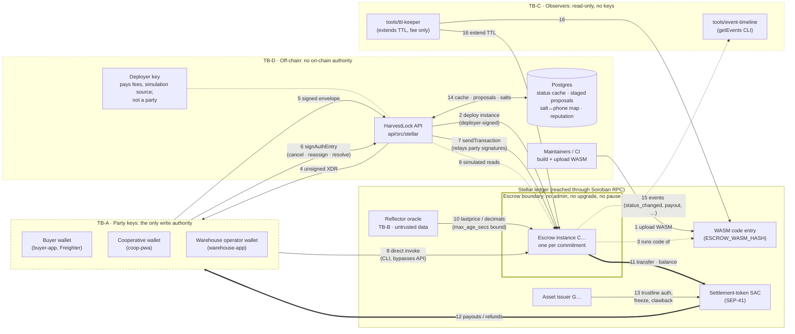

# Architecture — one commitment's world

One picture of what talks to what around a single commitment, with the trust
boundaries from [`threat-model.md`](./threat-model.md#trust-boundaries) drawn
on it. Each numbered arrow has a short section below that says what crosses it
and links to the doc or code that covers it, so this page also works as an
index into the rest of `docs/`.

Read [`HANDOFF.md`](../HANDOFF.md) first for what is built and what isn't.
This page covers how the pieces connect. It is not a status report.

> **Scope.** One escrow instance (one commitment) on Stellar **testnet**. API
> links point to the sibling [`HarvestLock`](https://github.com/Agrisettle/HarvestLock)
> repo, pinned to commit
> [`5d72704`](https://github.com/Agrisettle/HarvestLock/tree/5d72704a4b71b031a21e5af26ed8ddc978e3e3a9)
> so the line anchors stay valid. Links into this repo are relative and follow
> `main`.

## The diagram

**Legend.** A solid arrow changes state or submits something. A thick arrow
moves settlement tokens. A dotted arrow only reads or observes and carries no
authority. `TB-A` to `TB-D` are the trust boundaries described
[below](#trust-boundaries-on-the-diagram).

**No event consumer exists in the running system.** The contract publishes an
event on every transition ([`events.md`](./events.md)), but the API does not
subscribe to them. It updates its cache when it observes a change: after its
own submits and on `GET /commitments/:id` (see arrow 9 and arrow 14). The only
thing that reads the stream today is the `event-timeline` CLI (arrow 15).

## Trust boundaries on the diagram

These are the boundaries from [`threat-model.md` → Trust boundaries](./threat-model.md#trust-boundaries),
named so the diagram can point at them.

- **Escrow boundary (thick box).** The instance has no admin key, owner,
  pause, or upgrade entry point. Nothing outside it can change its code or
  terms after `initialize`, with one exception (see arrow 10).
  `interface.snapshot` and [`tools/wasm-imports`](../tools/wasm-imports/README.md)
  check this. Threat model entry 26.
- **TB-A: party keys.** Every arrow into the escrow that changes state is
  gated by `require_auth` on a buyer, cooperative, or warehouse-operator key,
  with one exception: the eight permissionless calls, which only finish a
  check the deal already fixed. Soroban auth entries are bound to the method
  and arguments, and they expire with the ledger. See
  [`authorization-matrix.md`](./authorization-matrix.md) and threat model
  entries 1–5.
- **TB-B: oracle.** Arrow 10 is the only arrow that carries untrusted external
  data into the contract. The contract does not trust it outright: the quote
  must be fresher than a bound chosen at `initialize`. Threat model entries
  17–20.
- **TB-C: read-only observers.** Indexers, the event CLI, and the API's
  simulated reads have no write path into the contract. The TTL keeper does
  submit transactions, but they pay rent and change no contract state.
- **TB-D: off-chain.** The API, its Postgres, and maintainers have **no
  on-chain authority**. No HarvestLock address appears anywhere in the
  contract (PRD §4.5). They can refuse to build a transaction or censor a user
  off-chain. They cannot sign as a party, move funds, or redirect anything.
  The deployer key is inside this box because it signs only deploy operations
  and pays simulation fees. It is never a principal of the escrow.

The token layer (arrows 11–13) is a dependency, not a boundary this contract
enforces. If the SAC or its issuer refuses a transfer, the whole call is
unwound. The contract treats that as a refusal it can recover from, never as a
misdirected payment (threat model entry 30 and the Token contract row in the
actor table).

## Arrow by arrow

### 1. Upload WASM

Maintainers build `contracts/escrow` with `stellar contract build` and upload
the result once. That creates a code entry addressed by its hash, and every
commitment's instance points at it. A new version means new WASM and a new
hash, and only new instances use it. Existing commitments keep the code they
were deployed with.
→ [`versioning.md`](./versioning.md), [`migration-runbook.md`](./migration-runbook.md),
[`tools/wasm-imports`](../tools/wasm-imports/README.md) (proves the artifact
links no upgrade or deployer host functions).

### 2. Deploy instance

`POST /commitments/deploy` creates a fresh, **uninitialized** instance from
`ESCROW_WASM_HASH` with `createCustomContract` and a random salt. Only the
deployer key signs, and no party's authorization is involved. Commitments are
created per instance, not through a factory. Before deploying, the API refuses
if the deployer's XLM balance is below a floor.
→ [`deploy.ts` `deployContractInstance`](https://github.com/Agrisettle/HarvestLock/blob/5d72704a4b71b031a21e5af26ed8ddc978e3e3a9/api/src/stellar/deploy.ts#L79),
[`server.ts` deploy route](https://github.com/Agrisettle/HarvestLock/blob/5d72704a4b71b031a21e5af26ed8ddc978e3e3a9/api/src/server.ts#L558),
[`constructor-batching.md` §1](./constructor-batching.md#1-what-the-current-flow-is-and-why-each-call-is-separate)
(why deploy, `initialize`, and `lock` are three separate transactions).

### 3. Instance runs code of

The instance stores its own state (the `Commitment`, allocation, and dispute
fields) and executes the shared code entry. Both ledger entries have TTLs, and
if either archives, the commitment stops being callable until it is restored.
→ [`storage-ttl.md`](./storage-ttl.md), arrow 16.

### 4. Unsigned XDR to the party's wallet

For every write, the API builds the invocation, simulates it to get the
resource footprint, and returns **unsigned** XDR. If the state machine rejects
the call during simulation, the API returns a typed 409 with the contract's
error code. The API never holds a buyer, cooperative, or operator key, by
design (PRD §4.6).
→ [`tx.ts` `buildInvokeTransaction`](https://github.com/Agrisettle/HarvestLock/blob/5d72704a4b71b031a21e5af26ed8ddc978e3e3a9/api/src/stellar/tx.ts#L24),
the [generic no-arg route](https://github.com/Agrisettle/HarvestLock/blob/5d72704a4b71b031a21e5af26ed8ddc978e3e3a9/api/src/server.ts#L732)
and the [`initialize` route](https://github.com/Agrisettle/HarvestLock/blob/5d72704a4b71b031a21e5af26ed8ddc978e3e3a9/api/src/server.ts#L565),
[`authorization-matrix.md` §1](./authorization-matrix.md#1-the-complete-matrix)
(who must sign which method) and [§1.1](./authorization-matrix.md#11-what-the-buyers-wallet-actually-signs)
(what the buyer's wallet actually signs).

> Drift to know about: since #270 the contract's `initialize` takes a
> `CommitmentTerms` struct ([`0002-interface-spec.md`](./0002-interface-spec.md)),
> but the API's [`initializeArgs`](https://github.com/Agrisettle/HarvestLock/blob/5d72704a4b71b031a21e5af26ed8ddc978e3e3a9/api/src/stellar/deploy.ts#L207)
> at the pinned commit still encodes the older 13 positional arguments. That
> only matches a WASM hash built before #270.

### 5. Signed envelope back to the API

The party signs in their own wallet and posts the envelope to
`/transactions/submit`. If the API also receives `refreshContractId`, it
clears its read cache after the submit is confirmed, re-reads the commitment,
and runs the observation hooks (arrow 14). If the transaction doesn't confirm
within 30 s, the API answers `202 PENDING` and finishes the same side effects
later, from `GET /transactions/:hash`.
→ [submit route](https://github.com/Agrisettle/HarvestLock/blob/5d72704a4b71b031a21e5af26ed8ddc978e3e3a9/api/src/server.ts#L1263),
[`tx.ts` `submitSignedTransaction`](https://github.com/Agrisettle/HarvestLock/blob/5d72704a4b71b031a21e5af26ed8ddc978e3e3a9/api/src/stellar/tx.ts#L66).

### 6. Staged multi-party signing

`cancel` (buyer and cooperative), `reassign_buyer` (outgoing buyer,
cooperative, and incoming buyer), and `resolve_dispute` (all three parties)
each need several distinct parties' Soroban auth in **one** invocation.
Signing the same envelope once per party fails. Instead:

1. A `…/propose` route simulates once and sets each auth entry's
   `signatureExpirationLedger` about a day ahead.
2. It stores the entries in Postgres.
3. Each party signs only their own entry with Freighter's `signAuthEntry`, in
   a separate request and possibly at a different time.
4. `finalizeMultiPartyProposal` rebuilds the transaction from the signed
   entries and the original footprint.
5. The proposer signs the outer envelope and submits through arrow 5.

On the contract side, `require_once_each` requires one signature per
*distinct* address, and auth entries are bound to the method and arguments,
so consent can't be partial, replayed, or reused for a different call.
→ [`multiParty.ts`](https://github.com/Agrisettle/HarvestLock/blob/5d72704a4b71b031a21e5af26ed8ddc978e3e3a9/api/src/stellar/multiParty.ts#L90),
the routes for [cancel propose](https://github.com/Agrisettle/HarvestLock/blob/5d72704a4b71b031a21e5af26ed8ddc978e3e3a9/api/src/server.ts#L1001),
[reassign propose](https://github.com/Agrisettle/HarvestLock/blob/5d72704a4b71b031a21e5af26ed8ddc978e3e3a9/api/src/server.ts#L1051),
[resolve propose](https://github.com/Agrisettle/HarvestLock/blob/5d72704a4b71b031a21e5af26ed8ddc978e3e3a9/api/src/server.ts#L1104),
and [sign](https://github.com/Agrisettle/HarvestLock/blob/5d72704a4b71b031a21e5af26ed8ddc978e3e3a9/api/src/server.ts#L1153),
threat model entries 3–5, [`dispute-scope.md`](./dispute-scope.md).

### 7. `sendTransaction` to the escrow

The API relays the signed transaction to the network. Its role here is
transport only. Whether the call succeeds depends on the party signatures
inside the transaction, never on the API's identity. Even an outright hostile
API could only refuse to relay, or relay late.
→ Threat model's actor table (the "HarvestLock / API maintainers" row),
[`dispute-frontrunning.md`](./dispute-frontrunning.md) (what relay timing can
and can't change).

### 8. Direct invoke, bypassing the API

Nothing requires the API. A party, or anyone at all for the permissionless
calls, can invoke the escrow with `stellar contract invoke` or their own code.
That skips the API's business-rule floors, such as the 1-hour minimum and
90-day maximum on `claim_window_secs` and the reputation bar on new buyers.
The contract never treated those floors as a security boundary.
→ Threat model entry 30, [`terminal-outcomes.md` §7](./terminal-outcomes.md),
[`e2e-transcript.md`](./e2e-transcript.md) and
[`0003-lifecycle-narrative.md`](./0003-lifecycle-narrative.md) (the flow
driven by the CLI).

### 9. Simulated reads

The API reads `get_status`, `get_commitment`, `get_oracle_config`,
`oracle_rate`, and `get_allocation` by **simulating** a call. It never submits
these. The deployer key serves as the simulation's source account, so it
signs nothing here. Results are cached for 5 s, and concurrent identical
reads share one request. These reads are also what drive the API's
observation hooks.
→ [`client.ts` `simulateRead`](https://github.com/Agrisettle/HarvestLock/blob/5d72704a4b71b031a21e5af26ed8ddc978e3e3a9/api/src/stellar/client.ts#L48),
[`GET /commitments/:contractId`](https://github.com/Agrisettle/HarvestLock/blob/5d72704a4b71b031a21e5af26ed8ddc978e3e3a9/api/src/server.ts#L1350),
[`api-docs.md`](./api-docs.md) (how to browse the view functions' rustdoc).

### 10. Reflector quote (TB-B)

`oracle_rate`, `resolve_fx_shortfall`, and `refresh_fx_quote_status` call
Reflector's `lastprice`, and use `decimals` to scale the result. The call is
cross-contract and read-only. The contract rejects a stale quote, a quote
dated in the future, or an asset the oracle doesn't quote, each with a hard
error. Within the freshness bound, the rate is trusted verbatim. Reflector's
testnet feed doesn't quote NGN today.
→ [`reflector.rs`](../contracts/escrow/src/reflector.rs),
[`reflector-decimals-assumption.md`](./reflector-decimals-assumption.md),
threat model entries 17–20.

Note that the oracle address is **not** strictly fixed at `initialize`.
`replace_oracle_config` lets the buyer and cooperative co-sign a replacement,
but only in `Delivered` and only before `fx_resolved` is set (#215). It
emits [`oracle_config_replaced`](./events.md#oracle_config_replaced).

### 11. Token transfers and balance reads

Every movement of funds is a SEP-41 `transfer` on the settlement-token
contract stored at `initialize`:

- Deposits: `lock`, `fund_remainder`, `fund_fx_shortfall`.
- Payouts: claims, reclaims, `settle`, `cancel`, and the expiry sweeps.

`settle` also reads `balance` and `decimals`. A deposit transfer is covered
by the paying party's own auth on the outer call. Payouts leave from the
contract's own address. State is written before each transfer. The contract
requires standard SEP-41 semantics, ideally a SAC.
→ Threat model entries 24, 29, and 30 (including the
`tests/nonstandard_token.rs` findings), [`fees-by-party.md`](./fees-by-party.md),
[`terminal-outcomes.md`](./terminal-outcomes.md).

### 12. Payouts and refunds reach party accounts

The SAC credits the buyer or cooperative account. With an issued asset (not
native XLM), the receiving account **must hold a trustline**, or the transfer
fails and the whole call unwinds. The warehouse operator is never paid.
→ [`trustline-prerequisites.md` §2](./trustline-prerequisites.md#2-per-role-trustline-prerequisites).

### 13. Issuer controls on the SAC

For an issued asset, the issuer account sets trustline authorization. Flags
such as `AUTH_REVOCABLE` and `AUTH_CLAWBACK_ENABLED` give it powers at the
protocol level that this contract can't override. Parties should check the
issuer's flags before the buyer signs `initialize`.
→ [`trustline-prerequisites.md` §3](./trustline-prerequisites.md#3-issuer-flags--threat-model-considerations),
[`scripts/test-asset.sh`](../scripts/test-asset.sh) (issues a test asset,
deploys its SAC, sets trustlines).

### 14. API ↔ Postgres

Postgres holds state the chain shouldn't hold or that the API needs fast:

- The commitments status cache, which is a cache and not an indexer.
- Staged multi-party proposals (arrow 6) and pending submissions (arrow 5).
- The salt↔phone map behind each on-chain `member_hash`. Deleting a row
  makes that hash unlinkable for good (NDPA erasure).
- Reputation strikes, which come from observing `Defaulted` or `Forfeited`.
- The farmer SMS queue.

Whenever the API reads the chain fresh, `observeCommitment` updates the cache
and then runs the reputation and SMS hooks. There's no background poller, so
the API doesn't notice a transition until someone reads that commitment.
→ [`observeCommitment`](https://github.com/Agrisettle/HarvestLock/blob/5d72704a4b71b031a21e5af26ed8ddc978e3e3a9/api/src/server.ts#L149),
[`reputation.ts`](https://github.com/Agrisettle/HarvestLock/blob/5d72704a4b71b031a21e5af26ed8ddc978e3e3a9/api/src/reputation.ts#L29),
[`notifications.ts`](https://github.com/Agrisettle/HarvestLock/blob/5d72704a4b71b031a21e5af26ed8ddc978e3e3a9/api/src/notifications.ts#L273),
[`allocation-salt-analysis.md`](./allocation-salt-analysis.md), threat model
entry 25, [`terminal-outcomes.md` §7](./terminal-outcomes.md).

### 15. Events

Every transition publishes `status_changed` (`initialize` deliberately does
not). Fund movements, disputes, FX resolution, allocation, and oracle
replacement each publish their own event. CI pins the event shapes with
`events.snapshot`. The reference reader is `tools/event-timeline`, a CLI that
pages through `getEvents` and decodes against the WASM's spec. No service
consumes the stream yet: the API only observes changes through arrow 9, and
the push-versus-poll question was decided in favour of polling for now.
→ [`events.md`](./events.md) (topics, data, RPC filters, retention window),
[`tools/event-timeline`](../tools/event-timeline/README.md),
[`constructor-batching.md` §5](./constructor-batching.md#5-events-vs-batching-for-the-apis-cache-context-for-69),
[`realtime-updates-spike.md`](https://github.com/Agrisettle/HarvestLock/blob/5d72704a4b71b031a21e5af26ed8ddc978e3e3a9/docs/realtime-updates-spike.md).

### 16. TTL extension

Reading a contract over RPC does not extend its TTL. `tools/ttl-keeper` checks
when the instance entry and the WASM code entry are due to expire. It extends
any entry under its threshold with `stellar contract extend`, which needs only
a funded fee-payer, not a party key. The contract extends its own instance
TTL inside every call that is actually submitted, but arrow 9's simulated
reads persist nothing. A commitment nobody transacts on still ages out, and
so does the shared code entry.
→ [`tools/ttl-keeper`](../tools/ttl-keeper/README.md),
[`storage-ttl.md`](./storage-ttl.md).

## Keeping this page honest

- A new component that talks to the escrow, or a new route in `api/src/stellar/`
  that changes what crosses an arrow, gets a new arrow and section here in the
  same PR.
- A change to a trust boundary is a [`threat-model.md`](./threat-model.md)
  change first. This page follows it.
- When API line numbers move, re-pin the `HarvestLock` links to a newer
  commit, all of them at once, rather than mixing commits.
