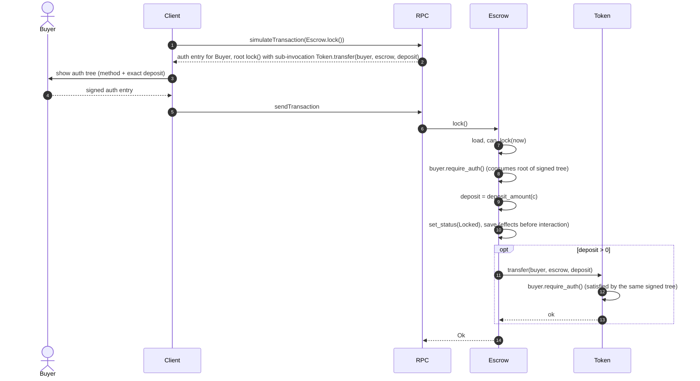
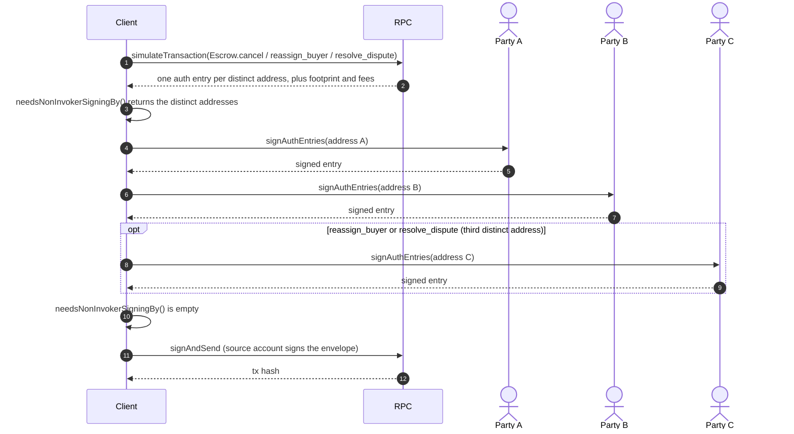
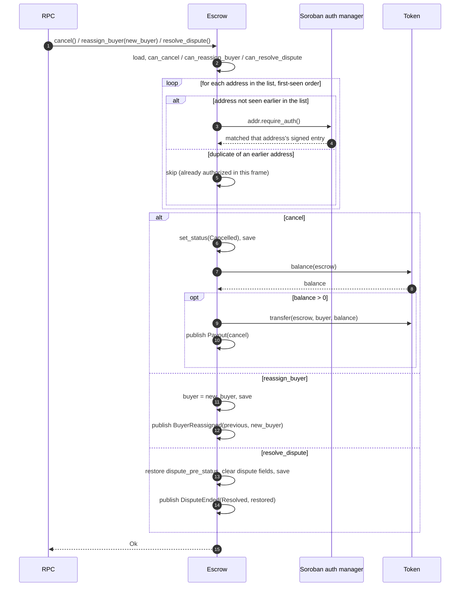
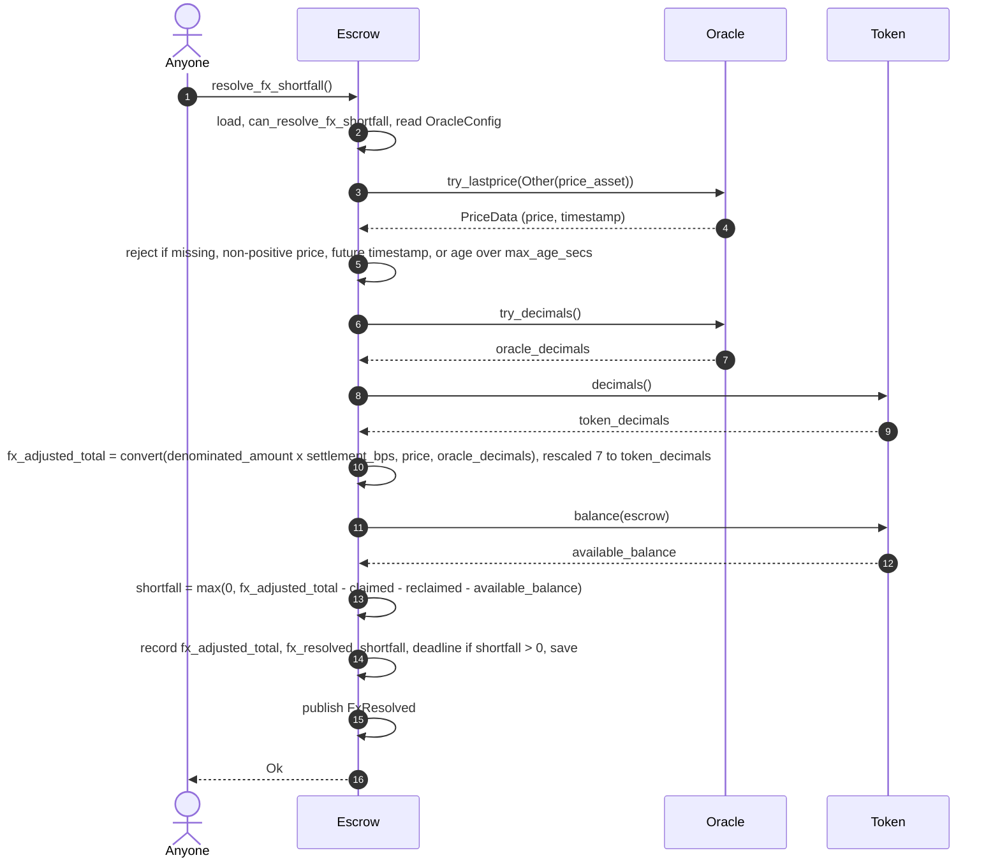
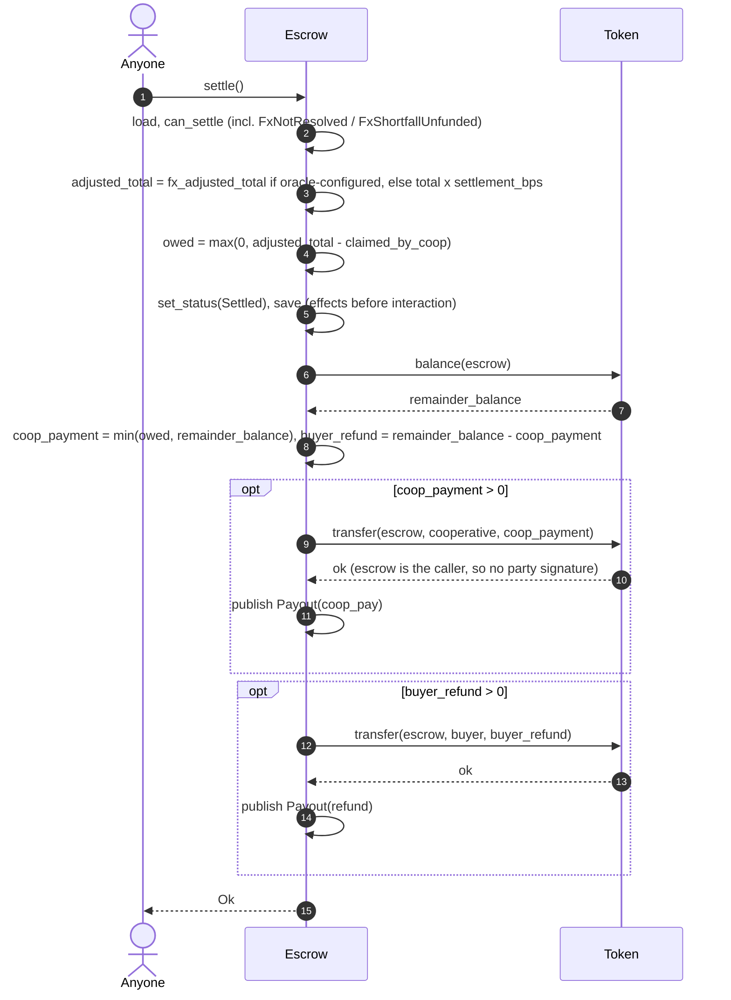

# Sequence diagrams — who signs what, and which contracts get called

The state machine diagram from #34 shows *what* can happen. This doc shows
*how*, for the calls where it matters to an integrator: who has to sign, which
auth entries a wallet is asked for, and which other contracts the escrow calls
during the invocation.

Ground truth is `contracts/escrow/src/lib.rs`. Each diagram follows the order of
calls in the function body. The auth shapes match
[`authorization-matrix.md`](./authorization-matrix.md), which remains the full
per-function list. If a diagram and the code disagree, the code is right and
the diagram needs fixing.

Participants used throughout:

| Participant | What it is |
| --- | --- |
| `Client` | The integrator's app: builds, simulates and submits the transaction (`@stellar/stellar-sdk` `AssembledTransaction` in the examples) |
| `RPC` | Soroban RPC (`simulateTransaction` / `sendTransaction`) |
| `Escrow` | This contract, one instance per commitment |
| `Token` | The settlement token's SEP-41 contract (a SAC for XLM/USDC) |
| `Oracle` | The Reflector-compatible price oracle in `OracleConfig.oracle_contract` |

---

## 1. `lock`: one buyer signature covers the nested token transfer

There is no `approve()` step. The buyer's authorization for `Escrow.lock` is a
tree: the root is the `lock` invocation, and it has one sub-invocation,
`Token.transfer(buyer, escrow, deposit)`. Signing that tree satisfies both
`c.buyer.require_auth()` in `lock` and the token's own `require_auth(from)`.
The deposit amount is part of the signed tree, so a wallet shows the amount and
not only the method name (see authorization-matrix §1.1).
`fund_remainder` and `fund_fx_shortfall` have the same shape with a different
amount.

If the buyer is also the transaction source, the buyer's auth uses source
account credentials. The envelope signature covers it and no separate auth
entry appears. The tree is the same either way.

---

## 2. Multi-party calls: collecting signatures off-chain

`cancel`, `reassign_buyer` and `resolve_dispute` each need more than one party
in the same invocation. Every party signs its own auth entry for the same
transaction. The client simulates once, asks the assembled transaction which
addresses still need to sign, collects one signature per distinct address and
submits. This is the flow in
[`examples/ts/cancel-multiparty.ts`](../examples/ts/cancel-multiparty.ts).

| Function | Addresses passed to `require_once_each`, in order |
| --- | --- |
| `cancel` | `buyer`, `cooperative` |
| `reassign_buyer(new_buyer)` | `buyer`, `cooperative`, `new_buyer` |
| `resolve_dispute` | `buyer`, `cooperative`, `warehouse_operator` |

Each entry is bound to this contract instance, this method and these
arguments. A signature for one commitment cannot cancel another, and a
signature for `cancel` cannot resolve a dispute. Tests such as
`cancel_auth_entry_for_one_instance_cannot_cancel_another` pin this.

---

## 3. Multi-party calls on-chain: `require_once_each` deduplication

When two roles share one address, for example a cooperative that also runs the
warehouse, that address signs **once**. Soroban aborts on a second
`require_auth()` for an address in the same frame (`Auth/InvalidAction`), so
`require_once_each` skips any address it has already seen. Simulation shows the
same thing from the client side: shared roles produce one auth entry, not two.

Worked example, `resolve_dispute` with `cooperative == warehouse_operator`:
the list is `[buyer, coop, coop]`, so `require_auth()` runs for `buyer` and
`coop` only, and the client collects two signatures. Only `cancel` moves funds.
Its transfer goes from the escrow itself, so no party signs it (see §5).

---

## 4. `resolve_fx_shortfall`: two oracle calls, then token reads

Permissionless: anyone can submit it, and nobody signs anything beyond the
transaction envelope. It makes two calls to the oracle and two to the token.
All of them are reads, and none needs auth. Either oracle failure returns a
contract error (`OracleUnavailable` and similar) and does not abort the host.
The error rolls back the whole invocation, so nothing is recorded.

If `shortfall > 0`, the buyer pays it next with `fund_fx_shortfall`, which has
the same signed-tree shape as `lock` in §1. `settle` refuses to run until that
is done.

---

## 5. `settle`: one balance read, then up to two transfers

Permissionless. The payouts go **from** the escrow contract, and the token's
`require_auth(from)` for the contract's own address is satisfied because the
escrow is the direct caller. No party signs anything. The split is computed
from recorded state and the live balance.

The two transfers together always add up to the whole balance, so `settle`
leaves the escrow at zero.
